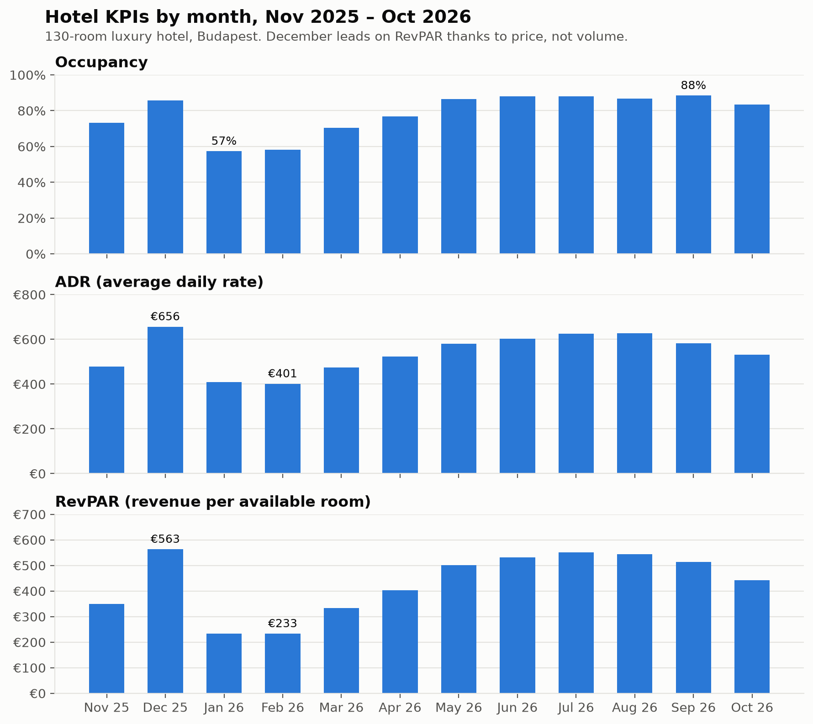
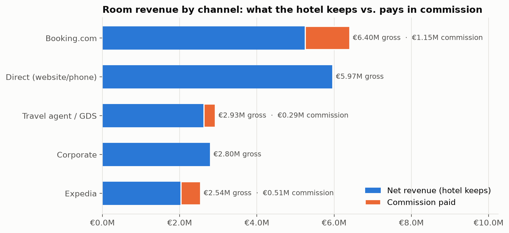
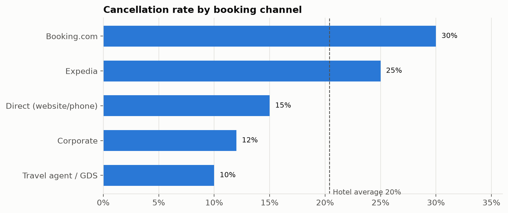

# Hotel KPIs: 12 months of a 130-room luxury hotel in Budapest

**Business problem.** A revenue manager needs to know how the hotel performed each month:
how full it was, at what price it sold rooms, which booking channels bring the most money
after commission, and where bookings are lost to cancellations.

**What I did.** Built a 12-month SQLite database (18,775 bookings, Nov 2025 – Oct 2026), wrote SQL
to calculate the standard hotel KPIs (occupancy, ADR, RevPAR, cancellation rate, revenue by
channel, gross and net of commission), and turned the results into charts with Python.



## Key results
| KPI (full year) | Value |
|---|---|
| Room revenue | **€20.6M** |
| Occupancy | **78.7%** |
| ADR (average daily rate) | **€553** |
| RevPAR (revenue per available room) | **€435** |
| Commission paid to OTAs and agents | **€1.95M** (9.5% of room revenue) |

- **Strong seasonality.** Occupancy runs from 57% in January to 88% in September. RevPAR in
  January and February (≈€233) is less than half of December's.
- **December wins on price, not volume.** It has the highest RevPAR (€563) despite lower occupancy
  than summer, because Christmas and New Year push ADR to €656.
- **Booking.com is the largest channel but not the most valuable.** €6.4M gross, but €1.15M goes
  to commission, so the hotel keeps €467 per night against €570 for a direct booking. Moving 10% of
  Booking.com nights to direct booking would save about €115k a year.
- **OTAs cancel most.** Booking.com cancels 30% of bookings and Expedia 25%, against 10–15% for
  direct, corporate and travel-agent bookings.

| Revenue by channel | Cancellation rate by channel |
|---|---|
|  |  |

## How the KPIs are calculated
- **Occupancy** = room-nights sold ÷ room-nights available (130 rooms × days in month)
- **ADR** = room revenue ÷ room-nights sold
- **RevPAR** = room revenue ÷ room-nights available = occupancy × ADR
- **Cancellation rate** = cancelled bookings ÷ all bookings

Stays that cross a month end are split night by night: each booking is joined to a calendar
table, so a 29 Nov – 3 Dec stay counts 2 nights in November and 2 in December.

## Tools
SQL (SQLite: CTEs, joins, CASE WHEN, date functions) · Python (pandas, matplotlib) · Git

## Project structure
```
data/hotel.db              SQLite database (generated)
sql/01_explore.sql         SQL basics: filters, grouping, joins
sql/02_occupancy.sql       occupancy by month, weekday vs weekend
sql/03_adr_revpar.sql      ADR and RevPAR by month and room type
sql/04_cancellations.sql   cancellation rate and booking lead time
sql/05_channel_revenue.sql revenue by channel, gross vs net of commission
src/generate_data.py       builds the fake database (fixed random seed)
src/run_sql.py             runs a .sql file and prints the results
src/make_charts.py         runs the SQL and saves the charts in output/
```

## Run it
```bash
cd 01-hotel-kpis
python3 src/generate_data.py                      # build the database
python3 src/run_sql.py sql/03_adr_revpar.sql      # print any query's results
python3 src/make_charts.py                        # save the charts
```

*The data is synthetic. It was generated to resemble a 5-star Budapest hotel (seasonal prices,
Christmas and summer peaks, real-world channel commission levels), so no real guest data is used.*
