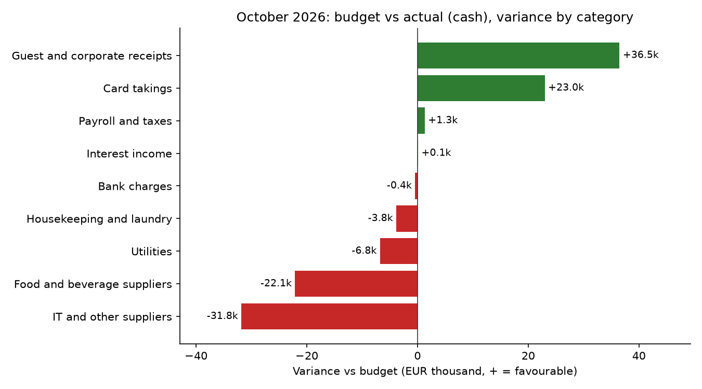

# Ledger reconciliation: does the bank agree with the books?

**Business problem.** At every month-end a hotel finance team checks that the cash account in
the general ledger (GL) agrees with the bank statement. When it doesn't, every difference has
to be found, explained and, if it is an error, corrected. Then the corrected figures are
compared with the budget.

**What I did.** Reconciled one month (October 2026) of a 130-room Budapest luxury hotel's
operating bank account in Python. Two matching passes pair bank lines with GL entries, the
leftovers are classified into timing items and real errors, a reconciliation statement proves
the adjusted balances agree, and the correcting entries go to an Excel report. Finally the
corrected ledger is compared with the October budget.



## Key results
| Step | Result |
|---|---|
| Difference to explain | GL EUR 1,041,914.39 vs bank EUR 987,002.82 → **EUR 54,911.57** |
| Pass 1: reference + amount | **178** matches |
| Pass 2: date + amount | **2** more (references typed wrongly, e.g. `PAY-5400` for `PAY-5040`) |
| Exceptions classified | **17**, none left to investigate |
| Reconciled balance | **EUR 1,026,745.47** on both sides, difference 0.00 |
| Correcting entries | **8** (2 duplicates, 2 wrong amounts, 2 bank fees, interest, 1 unidentified receipt) |

**Reconciliation statement, 31 October 2026 (EUR)**
| Bank side | | GL side | |
|---|---:|---|---:|
| Balance per bank | 987,002.82 | Balance per GL | 1,041,914.39 |
| + Deposits in transit (card takings 30–31 Oct) | 54,678.60 | − Duplicate postings | (15,813.74) |
| − Outstanding payments | (14,935.95) | ± Amount corrections | (180.00) |
| | | − Bank fees not booked | (1,927.36) |
| | | + Interest not booked | 412.18 |
| | | + Unidentified receipt | 2,340.00 |
| **Adjusted bank balance** | **1,026,745.47** | **Adjusted GL balance** | **1,026,745.47** |

**Budget vs actual.** Net cash flow EUR 176,745 vs a budget of EUR 180,800 (−2.2%). Four lines
pass the materiality test (≥ 5% and ≥ EUR 5,000): IT and other suppliers (−53%, EUR −31.8k),
food and beverage suppliers (−14.7%, EUR −22.1k), utilities (−14.1%, EUR −6.8k), and guest and
corporate receipts (+10.1%, EUR +36.5k). Bank charges are 28.5% over budget but only EUR 427,
so they are not flagged.

## How it works
| Script | What it does |
|---|---|
| `src/generate_data.py` | Builds October's bank statement and GL with 17 planted problems; checks they explain the whole difference |
| `src/match_exact.py` | Pass 1: inner join on reference + amount (in cents), with a counter so one bank line can't match two duplicates |
| `src/match_date_amount.py` | Pass 2: the same join on date + amount, to catch wrongly typed references |
| `src/classify_exceptions.py` | Rules for what is left: timing (deposits in transit, outstanding payments) vs errors (duplicates, wrong amounts, unbooked bank items) |
| `src/reconciliation_report.py` | Reconciliation statement, correcting entries, Excel report `output/reconciliation_oct2026.xlsx` |
| `src/budget_vs_actual.py` | Applies the corrections, groups by budget category, variance and materiality flag, chart |

## Tools
Python (pandas: merge/anti-join, groupby; openpyxl for the Excel report; matplotlib) · Git

## Run it
```bash
cd 02-ledger-reconciliation
python3 src/generate_data.py
python3 src/match_exact.py
python3 src/match_date_amount.py
python3 src/classify_exceptions.py
python3 src/reconciliation_report.py
python3 src/budget_vs_actual.py
```

*The data is synthetic (fixed random seed). It is modelled on a hotel's operating account:
daily card settlements that arrive the next business day, corporate invoice payments, supplier
payments, payroll and utilities. `data/answer_key.csv` lists the planted problems, so the
results can be checked.*
