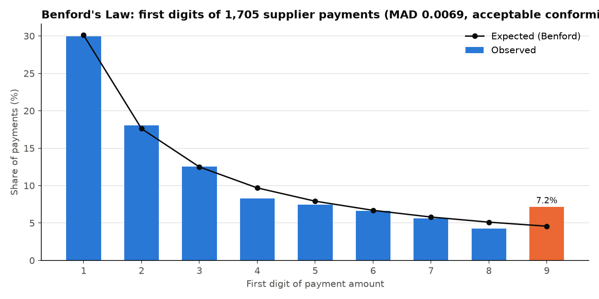

# Audit analytics: which payments and journal entries look suspicious?

**Business problem.** An auditor can't check thousands of transactions by hand, and a random
sample of 25 can easily miss a fraud. Audit analytics tests **100% of transactions** with code and
points the auditor at the few that break the rules. I tested a full year (Nov 2025 – Oct 2026) of a
130-room Budapest luxury hotel's books: **1,705 supplier payments** and **1,716 journal entries**.

**What I did.** Ran the tests audit firms use under ISA 240 (fraud): a Benford's Law test,
duplicate-payment tests, payment-control tests (approval limit, self-approval, new vendors, split
payments) and journal-entry tests (weekend, after hours, round amounts, just below the review
limit, self-approval, rare posters). Then combined every flag into a weighted **risk register**
and an Excel audit report.



## Key results
| Test | Finding |
|---|---|
| Benford's Law | First digit 9 in **7.2%** of payments vs 4.6% expected (z = 5.0). Overall fit still "acceptable" (MAD 0.0069): the per-digit test and the vendor drill-down found the cause |
| Duplicate payments | **10 invoices paid twice, EUR 17,453**: 6 exact, 4 with a retyped invoice number (`41641` vs `41614`) |
| Payment controls | A vendor created mid-year by an AP clerk received **18 payments, EUR 174,433**, every one between EUR 9,400 and 9,990 (just under the EUR 10,000 approval limit) and **approved by the same clerk** who entered it |
| Journal entries | 27 of 597 manual entries flagged. **JE01716**: Saturday 31 Oct, 23:41, EUR 49,900 (just under the EUR 50,000 review limit), self-approved, fails 5 of 6 tests |
| Risk register | **58 items** (1.7% of transactions) to review; all **26 High-risk items linked to one user** → referred for fraud investigation |
| Check against the planted answer key | **53 of 53** planted problems found; **5 false positives**, all ranked Low |

**The story the tests tell together.** One clerk created a new supplier, paid it EUR 174k in
payments kept just under the approval limit, approved them herself, and booked EUR 264k of
"consulting fees" to the same supplier through journal entries. Each test alone has innocent
explanations; five independent tests pointing at the same vendor and user do not.
The control failure behind it: one person could create a vendor, enter payments **and** approve them.

**False positives, cleared with evidence.** The round-amount test also flagged a monthly rent of
exactly EUR 12,000.00 (recurring, under contract), and the below-limit tests caught a VAT payment
and three electricity bills. Flags are a starting point for judgment, not proof.

## How it works
| Script | What it does |
|---|---|
| `src/generate_data.py` | Builds the payments, journal entries and vendor master with 53 planted problems (fixed seed) |
| `src/benford.py` | First-digit test: observed vs expected shares, z-test per digit, MAD (Nigrini thresholds), drill-down by vendor |
| `src/duplicates.py` | Exact duplicates (vendor + invoice + amount) and near duplicates (self-join on vendor + amount, invoice similarity) |
| `src/payment_controls.py` | Approval limit, just-below-limit share by vendor, self-approval, new vendors, split payments per 100 payments |
| `src/journal_tests.py` | Six tests on manual entries, recurring entries cleared as false positives |
| `src/risk_score.py` | Weighted score per item (3 = breaks a control, 2 = avoids one, 1 = unusual) plus a link rule for items tied to high-risk parties |
| `src/audit_report.py` | Excel report `output/audit_report_fy2026.xlsx` (summary, risk register, detail sheets) and the answer-key check |

## Tools
Python (pandas: self-joins, rolling date windows, groupby; numpy; openpyxl for the Excel report; matplotlib) · Git

## Run it
```bash
cd 03-audit-analytics
python3 src/generate_data.py
python3 src/benford.py
python3 src/duplicates.py
python3 src/payment_controls.py
python3 src/journal_tests.py
python3 src/risk_score.py
python3 src/audit_report.py
```

*The data is synthetic (fixed random seed), modelled on a hotel's accounts payable and general
ledger. Names of staff and the vendor "Pannon Advisory Kft" are invented. `data/answer_key.csv`
lists the planted problems so the tests can be checked.*
