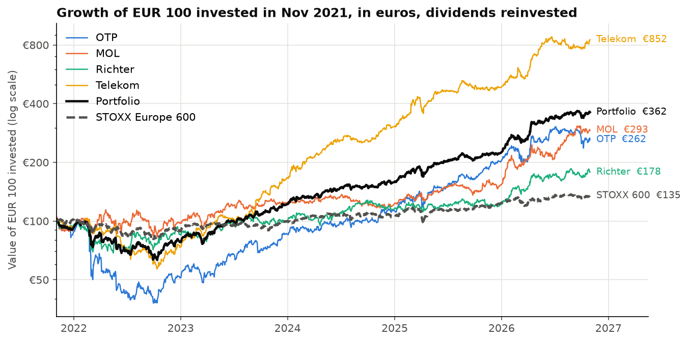
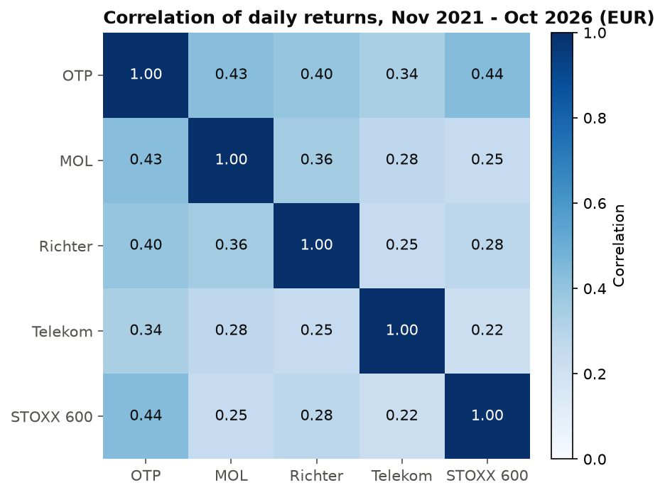
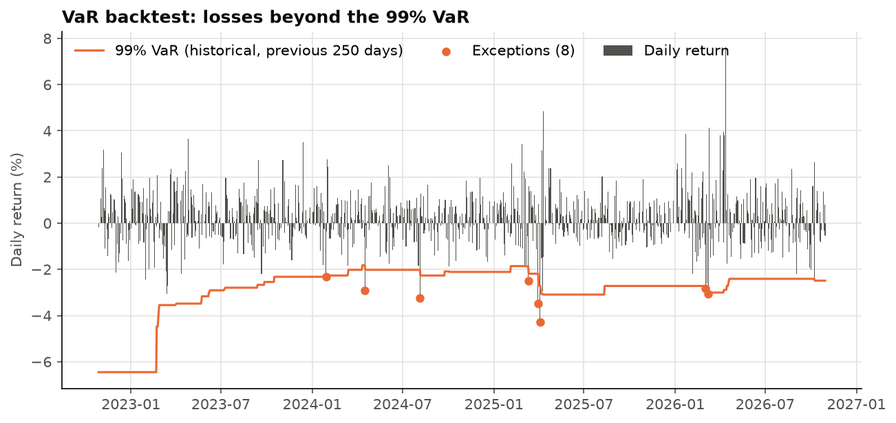

# Portfolio risk: four Hungarian blue chips through a euro investor's eyes

**Business problem.** A euro-based investor holds equal stakes in the four largest companies on
the Budapest Stock Exchange: OTP Bank, MOL, Richter Gedeon and Magyar Telekom. How risky is that
portfolio compared with the European market, what drives the risk, and how much could it lose
on a bad day?

**What I did.** Downloaded 5 years of daily prices (Nov 2021 – Oct 2026), converted them to euros,
and measured return, volatility, Sharpe ratio and drawdown; correlations and diversification;
CAPM betas by OLS regression against the STOXX Europe 600; and 1-day Value at Risk and Expected
Shortfall for a EUR 100,000 portfolio, with a backtest. Then wrote a one-page
[risk summary](output/risk_summary.md) for the client, generated from the results.



## Key results
| | Portfolio | STOXX Europe 600 |
|---|---:|---:|
| Annual return | **29.7%** | 6.2% |
| Annual volatility | **20.0%** | 14.1% |
| Sharpe ratio (risk-free 2%) | **1.39** | 0.30 |
| Maximum drawdown | **−38.4%** | −22.5% |
| Beta to STOXX Europe 600 (R²) | **0.61** (0.18) | 1.00 |
| 1-day 99% VaR, EUR 100,000 | **EUR 3,213** | |
| 1-day 99% Expected Shortfall | **EUR 4,833** | |

- **Diversification removed 28% of the risk**: from 27.8% average stock volatility to 20.0% for the
  portfolio, thanks to low correlations (0.25–0.43). But correlations rose in the 2022 crisis
  (0.41 vs 0.31 in 2024–26), and the forint pushes all four stocks together for a euro investor
  (average correlation 0.34 in EUR vs 0.24 in HUF).
- **OTP is 25% of the money but 35.5% of the risk**: the most volatile stock and the only one with a
  beta above 1 (1.08).
- **Low beta is not low risk.** The portfolio's beta is 0.61, yet its volatility is higher than the
  market's: the market explains only 18% of its moves, the rest is Hungary-specific (currency,
  politics, sector taxes).
- **Fat tails.** Excess kurtosis of 7.2; a normal-distribution VaR (EUR 2,820) understates the
  historical 99% VaR by 12%. The historical VaR backtest had 8 exceptions in 995 days (about 10
  expected): Kupiec test passed, Basel green zone.
- **Recommendation:** hold it as a satellite next to a broad European core, decide on the EUR/HUF
  hedge explicitly, and trim OTP. Inverse-volatility weights only cut volatility to 19.4%, so the
  country and currency risks are the ones that matter.

| Correlations | VaR backtest |
|---|---|
|  |  |

## How it works
| Script | What it does |
|---|---|
| `src/download_prices.py` | Downloads adjusted daily prices from Yahoo Finance, aligns trading days, converts HUF to EUR, saves to `data/` |
| `src/common.py` | Shared settings (weights, risk-free rate, portfolio value) and `load_returns()` |
| `src/performance.py` | Annual return (CAGR), volatility (×√252), Sharpe ratio, maximum drawdown, growth chart |
| `src/correlation.py` | Correlation matrix, portfolio volatility √(w′Σw), risk contributions, crisis and currency checks |
| `src/capm.py` | CAPM regressions with statsmodels OLS and Newey-West (HAC) standard errors, weekly-beta robustness check |
| `src/var.py` | Historical and parametric VaR, Expected Shortfall, rolling backtest without look-ahead, Kupiec test |
| `src/risk_summary.py` | Writes the one-page client summary from the results |

## Tools
Python (pandas, numpy, statsmodels, scipy, matplotlib, yfinance) · Git

## Run it
```bash
cd 04-portfolio-risk
python3 src/download_prices.py      # optional: data/ already holds the prices used here
python3 src/performance.py
python3 src/correlation.py
python3 src/capm.py
python3 src/var.py
python3 src/risk_summary.py
```

*Real market data from Yahoo Finance, adjusted for dividends and splits. Historical analysis, not
investment advice or a forecast. Assumptions: equal weights rebalanced daily, no transaction costs
or taxes, risk-free rate 2% (approximate average ECB deposit rate over the period).*
