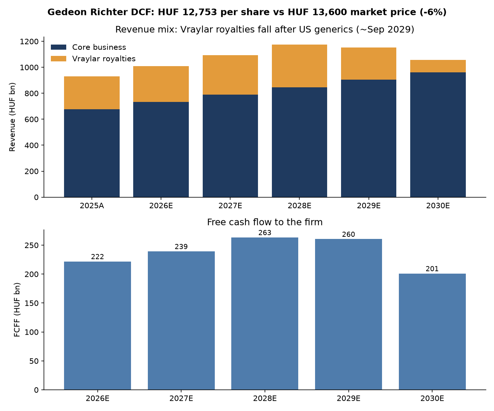

# Richter DCF: what is a Gedeon Richter share worth?

**Business problem.** Gedeon Richter (BSE: RICHTER) trades at only about 7x EBIT, cheap for a
profitable pharma company. Is the market right, or is the stock undervalued?

**What I did.** Built a 5-year discounted cash flow (DCF) model in Excel from Richter's 2025
annual report. Revenue is split into Vraylar royalties (paid by AbbVie on US sales) and the
core business, because the royalties are high-margin but face US generic competition from
~September 2029. Free cash flow is discounted at a CAPM-based WACC, with a Gordon-growth
terminal value and a bridge from enterprise value to value per share. A Python script
re-runs the base case as an independent check of the Excel formulas.



## Key results
| Output | Value |
|---|---|
| Value per share | **HUF 12,753** |
| Market price (mid-Nov 2026) | HUF 13,600 → **6% downside** |
| Enterprise value | HUF 2,024bn |
| WACC / terminal growth | 10.5% / 3.0% |
| Sensitivity range (WACC ±1pp, g ±1pp) | HUF 11,064 – 15,613 |

- **The patent cliff explains the low multiple.** Royalties are ~27% of revenue but most of the
  profit. As they fall away, group EBIT margin drops from ~32% to ~20% by 2030.
- **Ignoring it gives the wrong answer.** A first version that held the 31.5% margin forever
  valued the shares at HUF 20,300 (+49%), far above the analyst consensus of ~HUF 13,300.
- **The stock looks roughly fairly priced.** The result sits within 5% of the consensus target.

## How the model works
| Tab | What it does |
|---|---|
| Assumptions | All inputs in blue: share data, WACC (CAPM), royalty share and margin, growth, capex, working capital |
| Historicals | 2023–2025 reported figures with page references, plus margins and ratios |
| DCF | Revenue → EBIT → NOPAT → FCFF for 2026–2030, discounting, terminal value, equity bridge |
| Sensitivity | Value per share and upside for 25 WACC / growth combinations |

FCFF = EBIT × (1 − tax) + D&A − capex − increase in working capital.

## Assumptions to challenge
- **27% royalty share** is an outside estimate (Richter does not report it); **80% royalty margin** is my assumption.
- **WACC inputs** (6.8% HUF risk-free rate, beta 0.75, 5% equity risk premium) are assumptions, not market quotes.
- Valuation date is 31 Dec 2025, while the share price is from November 2026.

## Tools
Excel (formulas, sensitivity tables) · Python (openpyxl to build the workbook, pandas, matplotlib) · Git

## Project structure
```
src/build_model.py            writes the Excel model (every forecast cell is a formula)
src/make_chart.py             re-runs the base case in Python and saves the chart
output/Richter_Gedeon_DCF.xlsx the model: change blue cells on 'Assumptions'
output/dcf_summary.png        revenue mix and free cash flow chart
```

## Run it
```bash
cd 05-richter-dcf
python3 src/build_model.py     # build the Excel workbook
python3 src/make_chart.py      # check the value per share and save the chart
```

*Sources: [Richter Annual Report 2025](https://www.gedeonrichter.com/-/media/sites/hq/documents/investors/financial-reports/annual-report/en/2025/annual_report_2025_non_official_draft.pdf)
(consolidated statements, pp. 146–152), [FY2025 results release](https://www.gedeonrichter.com/en/news/260227)
(2026 guidance), Q4/FY2024 earnings report (2023 figures). Share price: BSE / Investing.com.*
