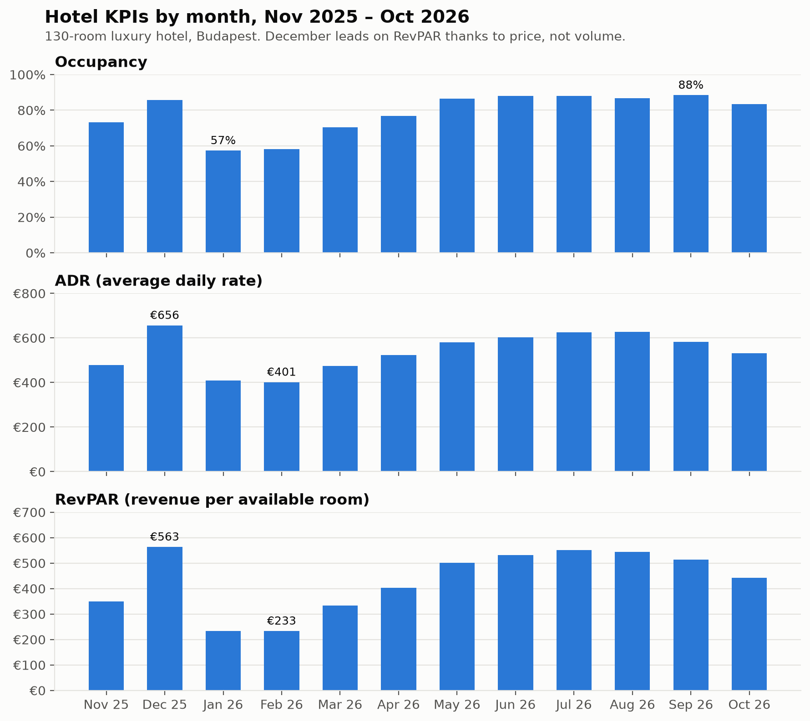

# Aliheydar Aliyev: Finance Analytics Portfolio

2nd-year BSc Applied Economics student at Corvinus University of Budapest, looking for
finance internships in Budapest (FP&A, audit, revenue management, risk).

Five projects that each solve a real junior finance task: hotel performance reporting
in SQL, ledger reconciliation, audit analytics, portfolio risk, and a DCF valuation of a listed
Hungarian company.

**Skills:** SQL (SQLite) · Python (pandas, matplotlib, statsmodels) · R (data cleaning, OLS, ANOVA) · Excel (DCF modelling, pivot tables) · Git

| # | Project | Business question | Key result | Tools | Status |
|---|---------|-------------------|------------|-------|--------|
| 1 | [Hotel KPIs](01-hotel-kpis/) | How is a 130-room Budapest luxury hotel performing by month and channel? | €20.6M room revenue, 78.7% occupancy; Booking.com costs €1.15M a year in commission | SQL, Python, pandas, matplotlib | ✅ Done |
| 2 | [Ledger reconciliation](02-ledger-reconciliation/) | Do the bank statement and general ledger agree, and where is the budget off? | | Python, pandas, Excel export | 🔄 In progress |
| 3 | [Audit analytics](03-audit-analytics/) | Which payments and journal entries look suspicious? | | Python, pandas, Benford's Law | Planned |
| 4 | [Portfolio risk](04-portfolio-risk/) | How risky is a small stock portfolio versus the market? | | Python, statsmodels, yfinance | Planned |
| 5 | [Richter DCF](05-richter-dcf/) | What is a Gedeon Richter share worth, given its 2029 Vraylar patent cliff? | HUF 12,753 per share vs HUF 13,600 price (6% downside), in line with analyst consensus | Excel, Python, openpyxl | ✅ Done |

[](01-hotel-kpis/)

## Run it yourself
Requires Python 3.12+.
```bash
pip install -r requirements.txt
```
Each project folder has its own README with run instructions.

*All datasets are synthetic (generated with a fixed random seed), public market data, or published company reports (Richter DCF). No confidential company or client data is used.*
